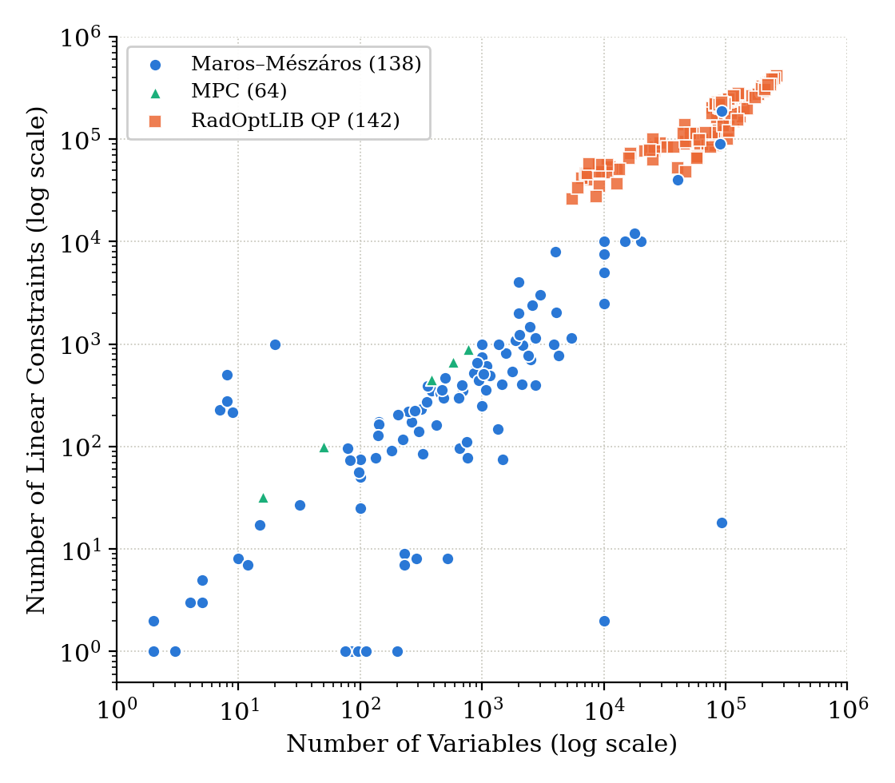

# RadOptLIB

A library of optimization problem instances from radiotherapy treatment planning.

The instances come from the planning of real clinical treatments and are released as plain
mathematical problems (matrices and vectors only), to serve as realistic, large-scale test cases for
optimization solvers and algorithms. The instance files are hosted on Harvard Dataverse; this
repository holds the manifests, the documentation and the `radoptlib` Python package for finding,
downloading, loading, checking and converting them.

## Problem classes

| Class | Formulation | Instances | Since | Details |
|---|---|---|---|---|
| `qp` | convex QP: minimize ½x'Qx + q'x + c subject to Gx ≤ h, l ≤ x ≤ u | 142 | 1.0 | [docs/qp.md](docs/qp.md) |

<p align="center">


</p>
<p align="center"><sub>Left: the QP instances by disease site and size class. Right: compared with the Maros–Mészáros
and MPC QP test sets. The constraint matrices of the RadOptLIB instances have 1.3–314 million nonzeros,
against at most 0.56 million in Maros–Mészáros and 3,502 in MPC.</sub></p>

Instances are named `rt-<class>-####` (for example `rt-qp-0001`), numbered separately per class.
Further classes (for example conic problems) will be added as new rows of this table.

## Quick start

Install the package:

```bash
pip install git+https://github.com/Radiotherapy-Optimization/RadOptLIB.git
```

or use it from a clone without installing it (only `numpy`, `scipy` and `h5py` are needed):

```bash
git clone https://github.com/Radiotherapy-Optimization/RadOptLIB.git
export PYTHONPATH=$PWD/RadOptLIB/src        # Windows PowerShell: $env:PYTHONPATH="$PWD\RadOptLIB\src"
```

When run from a clone, the package reads the manifests in the clone's `manifest/` folder.

```python
import radoptlib

names = radoptlib.select(problem_class='qp', disease_site='lung', type=1)
p = radoptlib.load(names[0])            # downloaded on first use, then read from the local cache
print(p)                                # <Problem rt-qp-0001: n=... m=... nnz_Q=... nnz_G=...>

x, dual_ineq_cons, dual_lower_bound, dual_upper_bound = my_solver(p.Q, p.q, p.G, p.h, p.l, p.u)   # your solver: primal x and the multipliers
print(radoptlib.verify_solution(p, x, dual_ineq_cons, dual_lower_bound, dual_upper_bound))
```

## Finding and downloading instances

Each problem class has a manifest, `manifest/<class>.csv`, with one row per instance: its name, the
disease site, the treatment modality, the type, the problem size, the file size, the download url and
the md5 checksum, plus the download url and md5 of its reference solution. The columns are described in the class documentation (for QP: [docs/qp.md](docs/qp.md)).

```python
radoptlib.list_instances('qp')                      # all manifest rows of a class
radoptlib.info('rt-qp-0001')                        # one row
radoptlib.download('rt-qp-0001')                    # one instance or multiple instance with list []

selected = radoptlib.select(disease_site='prostate', type=2)   # names matching any manifest columns
radoptlib.download(selected)                        # download exactly those

selected = radoptlib.select(size='small')                      # by size class: small, medium or large
selected = radoptlib.select(max_n_vars=50000, max_file_size_bytes=500e6)   # min_/max_ limits on any numeric column

```

The size classes (from the number of variables plus constraints) are defined in each class
document, for QP in [docs/qp.md](docs/qp.md#size-classes).

Files are stored in `~/.radoptlib` (or the folder in the `RADOPTLIB_DATA` environment variable).
Every download is checked against the md5 in the manifest, and files already present are not
downloaded again. Some instances are large (up to about 2 GB per file).

## Reference solutions

Reference solutions are provided for the instances, computed with
[Warm-IP](https://github.com/Radiotherapy-Optimization/Warm-IP).
They are **not guaranteed to be optimal**: each file stores the solver's primal and dual vectors,
and their quality can be checked with `verify_solution` (the files store no residuals). Solutions from other
solvers may be added later; the solver is part of the file name, `rt-<class>-####-sol-<solver>.h5`
(for example `rt-qp-0001-sol-warmip.h5`).

```python
sol = radoptlib.load_solution('rt-qp-0001')              # downloaded on first use, or pass a file path
radoptlib.verify_solution(radoptlib.load('rt-qp-0001'), sol['x'], sol['dual_ineq_cons'],
                          sol['dual_lower_bound'], sol['dual_upper_bound'])
```

## Citation

If you use RadOptLIB, please cite:

```bibtex
@inproceedings{jhanwar2026portpyai,
  title     = {PortPy.AI: A Benchmark for AI and Optimization in Cancer Radiotherapy Planning},
  author    = {Jhanwar, Gourav and Tefagh, Mojtaba and Huang, Qijie and Golkarieh, Alireza and Hong, Linda and Pham, Hai and Taasti, Vicki Trier and Tuomaala, Seppo and Magliari, Anthony and Folkerts, Michael and Zhou, Ying and Yang, Jie and Nadeem, Saad and Zarepisheh, Masoud},
  booktitle = {Advances in Neural Information Processing Systems (NeurIPS), Evaluations and Datasets Track},
  year      = {2026}
}
```

## License

- Code: MIT License (`LICENSE`)
- Data (instances, reference solutions and manifests): CC BY 4.0 (`LICENSE-DATA.md`)

## Contact

Bug reports and questions: please open an
[issue](https://github.com/Radiotherapy-Optimization/RadOptLIB/issues).
Other questions contact: Gourav Jhanwar (jhanwarg@mskcc.org) and for collaborations contact:
Masoud Zarepisheh (zarepism@mskcc.org).