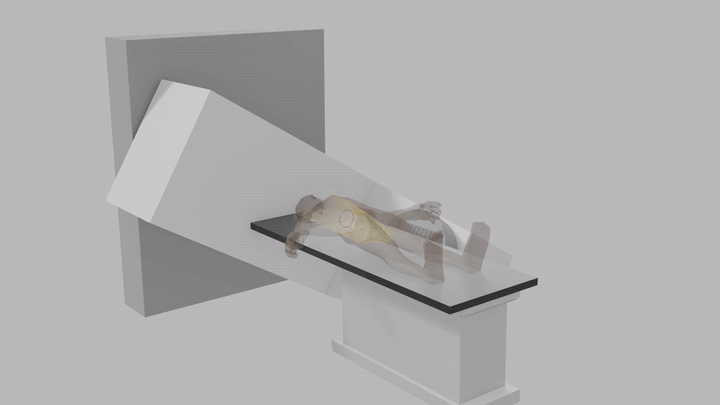
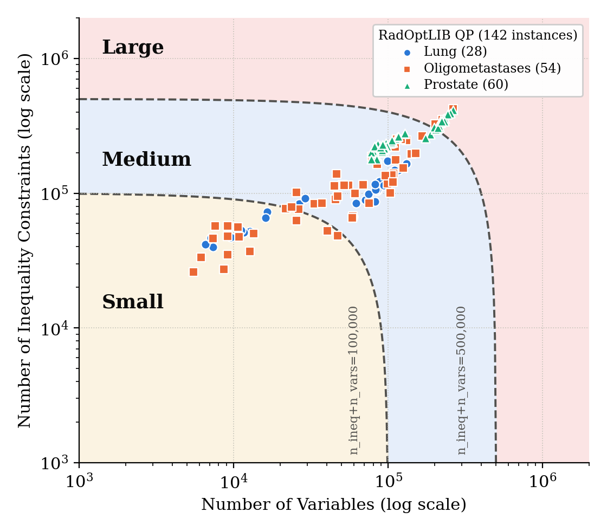
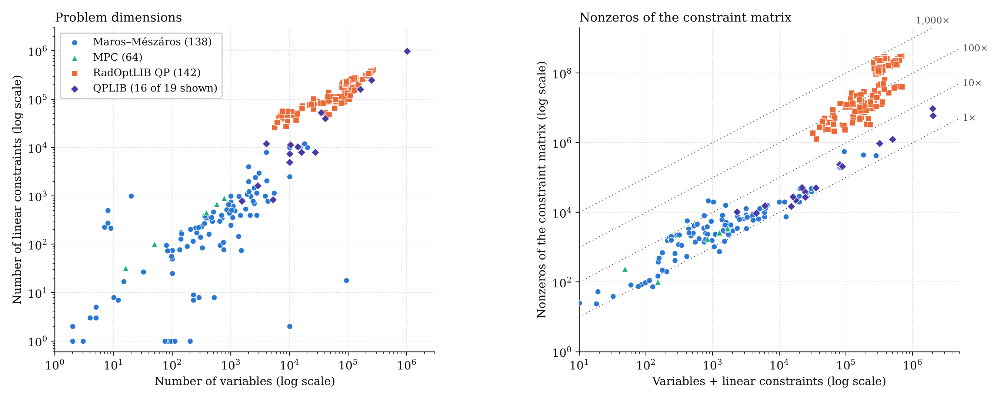

# RadOptLIB: A Benchmark Library of Radiotherapy Optimization Problems

[Dashboard](https://radiotherapy-optimization.github.io/RadOptLIB/dashboard/) · [Python quick start](examples/quickstart.ipynb) · [Documentation](docs/qp.md) ·
[MPS converter](mps/README.md) · [How to cite](#citation)

RadOptLIB provides large-scale optimization problems from cancer radiotherapy for benchmarking
solvers and algorithms. The problems are real: they come from the treatment planning system used
clinically at Memorial Sloan Kettering Cancer Center and are built from real patient cases. For each
patient, the system optimizes the shape and intensity of the radiation beams to fit that patient's
anatomy, so that more radiation reaches the tumor and less reaches the surrounding healthy tissue.
The instances have up to hundreds of thousands of variables and constraints and up to hundreds of
millions of nonzeros.

The first release contains convex continuous quadratic programs (QPs):

| Class | Problem type | Formulation | Instances | Details |
|---|---|---|---|---|
| `qp` | convex continuous QP | minimize ½x'Qx + q'x + c subject to Gx ≤ h, l ≤ x ≤ u | 142 | [docs/qp.md](docs/qp.md) |

Further problem classes are planned (conic, mixed-integer, nonconvex quadratic and general nonlinear
programs) and will be added as rows of this table.

The instances are released as plain mathematical problems (matrices and vectors only, with no images
or clinical records), so no radiotherapy software or knowledge is needed to use them. Every instance
comes with a [reference solution](#reference-solutions). The files are hosted on Harvard Dataverse in
HDF5 format, readable in [Python](examples/quickstart.ipynb), [Julia, MATLAB](docs/qp.md#reading-a-file)
and most other languages, and can be converted to MPS with a
[stand-alone program](mps/README.md). They can be browsed and downloaded in a web
[dashboard](https://radiotherapy-optimization.github.io/RadOptLIB/dashboard/), or from code with the
[`radoptlib` Python package](examples/quickstart.ipynb) provided in this repository.

<details>
<summary><b>What is radiotherapy optimization?</b></summary>
<br>



Radiotherapy treats cancer by directing high-energy radiation beams at the tumor, and is used for
more than half of all cancer patients. The treatment machine rotates around the patient and delivers
radiation from many directions. At the machine head, a set of movable metal leaves (the multi-leaf
collimator in the animation) shapes the beam, and the machine controls its intensity.

Every patient's anatomy is different, so the beam shapes and intensities are computed for each
patient by solving an optimization problem. The goal is to deliver the prescribed radiation dose to
the tumor while keeping the dose to the surrounding healthy organs as low as possible. The two goals
conflict, because the beams pass through healthy tissue to reach the tumor.

In the QP instances of this library, the variables are the beam parameters, together with auxiliary
variables that appear only linearly. The quadratic objective penalizes deviation of the delivered
dose from the intended dose. The constraints are dose limits on the tumor and the healthy organs,
results kept from earlier planning stages, and simple bounds. The constraint matrix contains dense
blocks, because each part of a beam contributes dose to many points in the body.

For a fuller introduction, see PortPy's
[Radiotherapy Optimization 101](https://github.com/PortPy-Project/PortPy#RadOpt101) and
[Zarepisheh et al. (2021)](https://doi.org/10.1287/inte.2021.1095). Animation from
[PortPy](https://github.com/PortPy-Project/PortPy).

<br clear="right">
</details>

## Problem statistics

<p align="center"></p>

Each point is one QP instance. The shaded regions are the size classes (small, medium, large). The
size classes and detailed statistics by disease site are in [docs/qp.md](docs/qp.md#problem-sizes).

## Comparison with other test sets

[Hans Mittelmann's Benchmarks for Optimization Software](https://plato.asu.edu/bench.html) collects
test sets and solver comparisons for many classes of optimization problems. For convex continuous QP,
the established test sets are the [Maros–Mészáros](https://www.cuter.rl.ac.uk/Problems/marmes.shtml)
collection (138 problems), the [MPC QP benchmark](https://github.com/qpsolvers/mpc_qpbenchmark) (64
problems from model predictive control) and the convex continuous instances of
[QPLIB](https://qplib.zib.de) (19 problems with linear constraints or bounds). The figures below
compare them with RadOptLIB in size.

<p align="center"></p>
<p align="center"><sub>Left: problem dimensions. Right: nonzeros of the constraint matrix; the dotted lines mark 1, 10,
100 and 1,000 nonzeros per variable-plus-constraint. Bounds on variables are not counted as constraints.
Three QPLIB instances have bounds only and are not shown.</sub></p>

RadOptLIB adds real problems that are both large and dense. Its instances are among the largest in
variables and constraints, and 103 of the 142 have a larger constraint matrix than any problem in the
other sets (up to 314 million nonzeros, against 9.6 million).

## Data format and access

The instances are distributed as HDF5 files, which can be read in Python, Julia, MATLAB, C/C++ and
most other languages; reading code is provided for [Python](examples/quickstart.ipynb),
[Julia and MATLAB](docs/qp.md#reading-a-file). For solvers that read MPS, a
[stand-alone converter](mps/README.md) is provided. No programming is needed to get the data: instances and
their reference solutions can be browsed, selected and downloaded in the [dashboard](https://radiotherapy-optimization.github.io/RadOptLIB/dashboard/), or directly from Harvard Dataverse.
Python users can also filter, download and load instances from code with the
[`radoptlib` package](examples/quickstart.ipynb) provided in this repository.

Each instance is one file named `rt-<class>-####.h5` (for example `rt-qp-0001.h5`), and its reference
solution is a second file named `rt-<class>-####-sol-<solver>.h5` (for example
`rt-qp-0001-sol-warmip.h5`). The manifest
`manifest/<class>.csv` (for QP, [manifest/qp.csv](manifest/qp.csv)) lists every instance with its disease site, type, problem size, file size,
download address and checksum, and the download address and checksum of its reference solution.

<details>
<summary><b>Browse and download instances in the dashboard (no programming)</b></summary>
<br>

The [dashboard](https://radiotherapy-optimization.github.io/RadOptLIB/dashboard/) shows all instances in a plot and a table.

1. Filter the instances by size class, disease site and type.
2. Select instances with the checkboxes in the table, or by clicking points in the plot.
3. Download the selection with the button (up to 10 instances or 5 GB at a time), with or without
   the reference solutions. For larger selections, the dashboard provides a download script for
   Windows, macOS and Linux that needs nothing installed, and lists of the file addresses and
   checksums.

The same files can be downloaded from the dataset page on Harvard Dataverse (link to be added at
release).

</details>

<details>
<summary><b>Read the HDF5 files in Julia, MATLAB or another language</b></summary>
<br>

Each `.h5` file holds the matrices and vectors of one problem in a simple layout: sparse matrices as
CSR arrays, vectors as plain arrays, and two text notes that describe the instance and the layout.
No RadOptLIB code is needed to read it. A reference solution file holds the primal solution and the
multipliers as plain arrays ([docs/qp.md](docs/qp.md#reference-solution-files)).

To look inside a file without any programming, open it in a free online HDF5 viewer such as
[myHDF5](https://myhdf5.hdfgroup.org) (drop the file onto the page). The smallest instance and its
reference solution are included in this repository under [examples/](examples) as a sample, and
these links open them directly in the viewer: [instance](https://myhdf5.hdfgroup.org/view?url=https%3A%2F%2Fraw.githubusercontent.com%2FRadiotherapy-Optimization%2FRadOptLIB%2Fmain%2Fexamples%2Frt-qp-0062.h5) ·
[reference solution](https://myhdf5.hdfgroup.org/view?url=https%3A%2F%2Fraw.githubusercontent.com%2FRadiotherapy-Optimization%2FRadOptLIB%2Fmain%2Fexamples%2Frt-qp-0062-sol-warmip.h5).

- **Julia and MATLAB:** short reading functions are in
  [docs/qp.md, "Reading a file"](docs/qp.md#reading-a-file).
- **Other languages:** any HDF5 library works, for example the HDF5 C/C++ library or the HDF5
  packages for R, Rust and Fortran. The layout is described in
  [docs/qp.md](docs/qp.md#instance-files).
- **Python:** use the `radoptlib` package ([quick-start notebook](examples/quickstart.ipynb)), or
  [`h5py` alone](docs/qp.md#reading-a-file).

HDF5 was chosen because it is supported in nearly every language and its built-in compression keeps
the files small: the 142 QP instances take about 82 GB, less than half of their uncompressed size.

</details>

<details>
<summary><b>Convert instances to MPS</b></summary>
<br>

`radoptlib2mps` is a stand-alone program for Windows, Linux and macOS that needs no Python and no
installation. Get it from the
[latest release](https://github.com/Radiotherapy-Optimization/RadOptLIB/releases/latest), download
the instances you want into a folder, and run:

```
radoptlib2mps FOLDER
```

For every instance in the folder it writes an MPS file next to the HDF5 file (`rt-qp-0001.mps.gz`
next to `rt-qp-0001.h5`). The MPS files describe exactly the same problems; they are produced on
your computer instead of being hosted because they are much larger than the HDF5 files. Full
instructions are in [mps/README.md](mps/README.md). In Python, `radoptlib.to_mps` does the same.

</details>

<details>
<summary><b>Filter, download and load instances in Python</b></summary>
<br>

Install the `radoptlib` package:

```bash
pip install git+https://github.com/Radiotherapy-Optimization/RadOptLIB.git
```

```python
import radoptlib

# Find instances. Every instance has a row in the manifest (disease site, type, sizes, ...).
rows  = radoptlib.list_instances('qp')                        # all rows of a problem class
row   = radoptlib.info('rt-qp-0001')                          # the row of one instance
names = radoptlib.select(disease_site='lung', size='small')   # names matching any manifest columns
names = radoptlib.select(max_n_vars=50000, max_file_size_bytes=500e6)   # or limits on numeric columns

# Download and load.
radoptlib.download(names)                 # into ~/.radoptlib; files already there are skipped
p = radoptlib.load(names[0])              # sparse p.Q and p.G; vectors p.q, p.h, p.l, p.u; scalar p.c

# Solve with your own solver and evaluate the result. The solver returns x and the multipliers of
# Gx <= h, x >= l and x <= u; evaluate_solution returns the objective value and the KKT residuals
# (primal residual, dual residual and duality gap).
x, dual_ineq_cons, dual_lower_bound, dual_upper_bound = my_solver(p.Q, p.q, p.G, p.h, p.l, p.u)
print(radoptlib.evaluate_solution(p, x, dual_ineq_cons, dual_lower_bound, dual_upper_bound))

# Reference solutions. The data include a reference solution (primal and dual vectors) for every
# instance, computed with the Warm-IP solver and stored as <name>-sol-warmip.h5. Evaluate it
# the same way as your own solution.
sol = radoptlib.load_solution(names[0])   # downloaded on first use
print(radoptlib.evaluate_solution(p, sol['x'], sol['dual_ineq_cons'], sol['dual_lower_bound'],
                                  sol['dual_upper_bound']))

# MPS. For solvers that read MPS files, write an instance as an MPS file (gzipped when the name
# ends in .gz). Without Python, the stand-alone program radoptlib2mps does the same.
radoptlib.to_mps(p, p.name + '.mps.gz')
```

The notebook [examples/quickstart.ipynb](examples/quickstart.ipynb) runs these steps on a small
instance and shows the output of each one, including an example of solving an instance with an
open-source solver. The residuals reported by `evaluate_solution` are defined in
[docs/qp.md](docs/qp.md#evaluating-a-solution).

</details>

## Reference solutions

Every instance has a reference solution, computed with
[Warm-IP](https://github.com/Radiotherapy-Optimization/Warm-IP). Each file stores the solver's primal
and dual vectors. The objective value and the residuals are not stored; they can be computed with
`evaluate_solution` ([docs/qp.md](docs/qp.md#evaluating-a-solution)). The reference solutions can be
downloaded together with the instances in the [dashboard](https://radiotherapy-optimization.github.io/RadOptLIB/dashboard/),
or with [`load_solution`](examples/quickstart.ipynb) in Python.

```python
sol = radoptlib.load_solution('rt-qp-0001')              # downloaded on first use, or pass a file path
radoptlib.evaluate_solution(radoptlib.load('rt-qp-0001'), sol['x'], sol['dual_ineq_cons'],
                            sol['dual_lower_bound'], sol['dual_upper_bound'])
```

## Citation

A paper dedicated to RadOptLIB is in preparation. Until it appears, please cite the paper below. The
RadOptLIB instances were generated with the clinical version of
[PortPy](https://github.com/PortPy-Project/PortPy), the open-source project that this paper presents.

```bibtex
@inproceedings{jhanwar2026portpyai,
  title     = {PortPy.AI: A Benchmark for AI and Optimization in Cancer Radiotherapy Planning},
  author    = {Jhanwar, Gourav and Tefagh, Mojtaba and Huang, Qijie and Golkarieh, Alireza and Hong, Linda and Pham, Hai and Taasti, Vicki Trier and Tuomaala, Seppo and Magliari, Anthony and Folkerts, Michael and Zhou, Ying and Yang, Jie and Nadeem, Saad and Zarepisheh, Masoud},
  booktitle = {Advances in Neural Information Processing Systems (NeurIPS), Evaluations and Datasets Track},
  year      = {2026}
}
```

## License

- Code: MIT License (`LICENSE`)
- Data (instances, reference solutions and manifests): CC BY 4.0 (`LICENSE-DATA.md`)

## Contact

- **Questions and bug reports:** please open an
  [issue](https://github.com/Radiotherapy-Optimization/RadOptLIB/issues), or contact Gourav Jhanwar
  (jhanwarg@mskcc.org), Memorial Sloan Kettering Cancer Center.
- **Principal investigator:** Masoud Zarepisheh (zarepism@mskcc.org), Memorial Sloan Kettering Cancer
  Center, also the contact for collaborations.
- **Collaborator and advisor:** Mojtaba Tefagh (m.tefagh@ed.ac.uk), University of Edinburgh.
